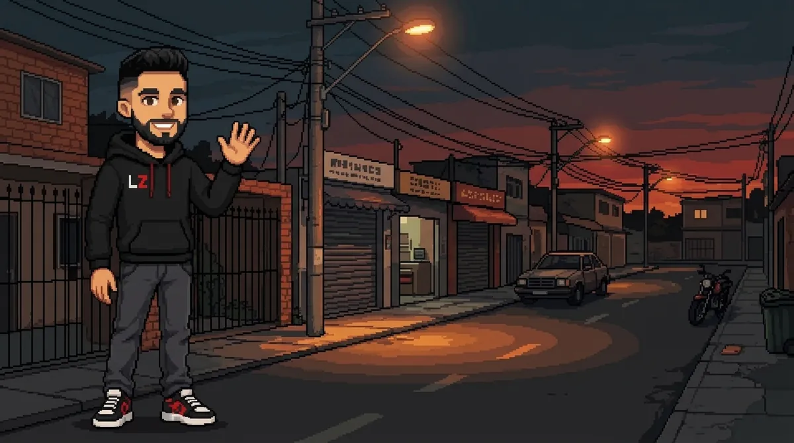

<div align="center">

<picture>
  <source media="(prefers-color-scheme: dark)" srcset="assets/logozany.svg">
  
</picture>

### Tecnologia · Automação · Segurança

Sites sob medida, cuidado técnico mensal e segurança de verdade para pequenas empresas.<br>
De Osasco e São Paulo para todo o Brasil.

<a href="https://www.logzany.com.br"></a> <a href="https://www.instagram.com/logzany/"></a> <a href="https://linkedin.com/in/gabriel-zanelato-89a7452aa/"></a> <a href="mailto:contato@logzany.com.br"></a>

<br><br>



</div>

```text
zany@logzany:~$ whoami
Gabriel Zanelato, o Zany. Desenvolvedor web, gestor técnico de plataformas
e pentester certificado DCPT (Desec Certified Penetration Tester).

zany@logzany:~$ cat missao.txt
Colocar pequenas empresas na internet do jeito certo: site rápido, seguro,
fácil de achar no Google e com alguém cuidando dele depois da entrega.
```

## O que a LogZany faz

| | Serviço | Na prática |
|:-:|---|---|
| 🌐 | **Sites e lojas** | Site sob medida, rápido no celular, pensado para aparecer no Google |
| 🛠️ | **Cuidado mensal** | Hospedagem gerenciada, domínio, SSL, backups, atualizações e suporte pelo WhatsApp |
| 🤖 | **Automação e IA** | Tirar do caminho as tarefas repetitivas do dia a dia |
| 📱 | **Conteúdo para redes** | Carrosséis, posts e vídeos curtos para o Instagram da empresa |
| 🛡️ | **Cibersegurança** | Avaliação de segurança e pentest, sempre com autorização por escrito |

## No ar

| Projeto | O que é |
|---|---|
| [**Hajime Sports**](https://www.hajimesports.com.br/) | Plataforma oficial e portal do tatame |
| [**Aulas Sportz**](https://aulassportz.com.br/) | Plataforma institucional de atividades extracurriculares |
| [**Fields**](https://fields.social.br/) | Site institucional |
| [**LogZany**](https://www.logzany.com.br) | O próprio site, com blog sobre sites, segurança e presença digital |

## Ferramentas do dia a dia

<p>
  
  
  
  
  
  
  
</p>

<a href="https://tryhackme.com/p/GaahZanelato"></a>

## A equipe


Por trás da LogZany está o Zany, com a supervisão rigorosa dos estagiários **Klaus** (siamês, chefe de qualidade) e **Ohana** (rajadinha, gerente de bem estar do teclado).

Antes do código, o Zany foi professor de Educação Física e de ginástica artística, e ensinou pensamento computacional e robótica. Daí vem o jeito de explicar tecnologia sem complicar.

<br clear="right">

<div align="center">

**Quer um site que funcione e alguém que cuide dele?**<br>
[Fale com a LogZany](https://www.logzany.com.br/conversar)

</div>
